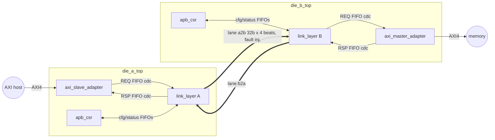

# D2D-Link: a UCIe-inspired chiplet die-to-die link controller

D2D-Link carries AXI4 traffic from a host on **Die A** to a memory on **Die B** over a
flit-based link layer with CRC-16, Go-Back-N retry, two credit-flow-controlled virtual
channels, link training/retraining, and three asynchronous clock domains. It is written in
synthesizable SystemVerilog and verified with open-source tools only: cocotb/pyuvm
constrained-random simulation with fault injection, SymbiYosys formal, Verilator and Verible
lint, and Yosys synthesis to SKY130.

> UCIe-*inspired*: the flit/retry/credit/training concepts follow die-to-die link practice,
> but the formats are this project's own and not UCIe-compliant.



## Key features
- AXI4 subset: 64-bit data, 32-bit address, 4-bit ID, INCR bursts of 1..16 beats, WSTRB,
  4 outstanding writes and 4 outstanding reads, strictly in-order execution (documented restriction).
- 128-bit flits sent as 4 beats on a 32-bit lane: type, 8-bit SEQ, **cumulative** piggybacked
  ACK and per-VC credit counts, 72-bit payload, CRC-16/CCITT-FALSE.
- Go-Back-N: replay buffer of 16 entries (window < half the sequence space), NAK on CRC error
  or sequence gap, replay timeout for lost tail flits or NAKs, replay after retrain.
- REQ/RSP virtual channels with independent credits (no protocol deadlock). Credits are
  returned from the RX CDC FIFO's synchronized read pointer, so there is no extra crossing.
- Training FSM RESET -> TRAIN -> ACTIVE -> RETRAIN -> FAILED, error-window retrain trigger,
  retry budget, and traffic preserved across retrain and across software recovery from FAILED.
- Three async clock domains (`clk_axi_a`, `clk_axi_b`, `clk_link`). Exactly 8 gray-code async
  FIFOs cross between them; nothing else does ([docs/cdc.md](docs/cdc.md)).
- APB3 CSRs per die: control, status, 5 saturating error counters (coherent snapshot across
  the CDC), thresholds, W1C interrupts.

## Results (all numbers from logs in this repo, details in [docs/results.md](docs/results.md))

| Metric | Result |
|--------|--------|
| System tests | 14 tests; final regression 44 jobs (2 seeds x default + small config): **44 / 44 pass** in 10.0 min |
| Transactions checked end to end | 5108 (0 lost, duplicated, reordered or corrupted) |
| Faulted flits injected and recovered | 3604 (1361 detected bad flits, 350 NAKs, 353 replays, 62 timeouts, 26 retrains) |
| Functional coverage | **233 / 233 bins (100.0%)**, [docs/coverage_report.md](docs/coverage_report.md) |
| Unit tests | 9 / 9 pass (CRC vs Python model, async FIFO under random clock ratios, replay buffer vs GBN model, ...) |
| Formal | 5 jobs / 10 tasks pass: **unbounded proofs** of async FIFO (no over/underflow, 1-bit gray steps, ordering), credit conservation, replay pointers, reduced Go-Back-N link (in order, no loss/dup over a lossy channel); training FSM BMC-20; all covers reached |
| Lint | Verilator `-Wall` 0 warnings, Verible 0 violations (7 justified waivers) |
| Area (estimate) | Die A 179,397 um^2, Die B 175,826 um^2 (SKY130 HD std-cell area, ~4.3k flops per die) |
| fmax (estimate) | about 48 MHz clk_link in SKY130 tt (ABC comb. path 20.8 ns: replay mux + 112-bit CRC); see results section 6 |
| Bugs found | 1 RTL bug, 1 design characterization, 5 testbench bugs, [docs/bug_log.md](docs/bug_log.md) |

## Repository layout
```
rtl/            synthesizable RTL (one module per file), rtl/common/ shared blocks, rtl/files.f
tb/unit/        cocotb unit tests (crc16, async_fifo, credit_counter, sync, replay_buffer, flit tx/rx, FSM)
tb/uvm/         pyuvm environment (d2d_env.py), 14 tests (d2d_tests.py), runner (run_test.py)
uvm_sv/         SystemVerilog UVM AXI agent + smoke test (EDA Playground, not run locally)
formal/         SymbiYosys jobs + property wrappers
syn/            synthesis reports (Liberty file downloaded on demand, not committed)
scripts/        run_regression.py, run_formal.sh, run_lint.sh, run_syn.sh, report.py, dk.sh
docs/           spec, microarch, cdc, verification plan, coverage report, bug log, results, lint waivers
docker/         Dockerfile of the tool environment
```

## How to run
Everything runs in a Docker image with the pinned open-source tools (Verilator 5.020, Yosys 0.33,
SymbiYosys, z3, Verible, Python 3.12 with cocotb 1.9.2, pyuvm 3.0.0, cocotb-coverage 1.2.0).
```bash
make image          # build the d2d-eda image (docker/Dockerfile)
make lint           # Verilator -Wall + Verible
make unit           # block-level cocotb tests
make regress        # all system tests, 2 seeds, default + small config, parallel, 15 min cap
make formal         # SymbiYosys jobs
make syn            # Yosys + SKY130 area/delay estimates
make report         # merge coverage -> docs/coverage_report.md
# single test with a fixed seed:
scripts/dk.sh "python tb/uvm/run_test.py --test crc_error_retry --seed 42 --config default"
```
If your network does TLS inspection (antivirus or corporate proxy), put its root certificate in
`docker/local-ca.crt` (git-ignored) before `make image`.

**SystemVerilog UVM:** `uvm_sv/` runs on [EDA Playground](https://www.edaplayground.com)
(UVM 1.2; add `uvm_sv/*.sv`, `rtl/**/*.sv`, `rtl/*.svh`; top `tb_top`). It was
syntax-checked locally with Verible but **is not simulated locally**.

## Scope reductions and deviations (honest list)
- **Time box:** the requested budget was 2 hours; the actual session took considerably longer,
  mainly because of environment setup (slow network, TLS inspection breaking the container's
  certificate chain, an incompatible distro boolector). No checks were removed to save time.
- **Tools:** OSS CAD Suite (600 MB) was replaced by Ubuntu packages. yices is unavailable and
  the packaged boolector is too old for yosys-smtbmc, so formal uses z3 and ABC PDR. No
  yosys-slang or sv2v: the RTL stays within Yosys 0.33's native SystemVerilog subset.
  GTKWave was not installed (VCD/FST dumps can be viewed on the host). OpenSTA was not available.
- **Coverage model:** the len x ID cross uses 4 ID groups (64 bins) rather than all 16 IDs;
  all 16 IDs are covered separately for reads and writes.
- **Fault model:** injected errors stay inside CRC-16's guaranteed detection envelope (<= 3
  random bit flips, bursts <= 16 bits). Undetectable patterns are a residual-error-rate topic.
- **Die B executes one transaction at a time**, so link utilization is low (one flit per AXI beat).
- **Unit tests** cover the common blocks, replay buffer, flit TX/RX and training FSM. The AXI
  adapters, CSR block and die tops are verified at system level only.
- Code coverage (Verilator `--coverage`) was not collected.

## Documentation
[spec](docs/spec.md), [micro-architecture](docs/microarch.md), [CDC](docs/cdc.md),
[verification plan](docs/verification_plan.md), [coverage](docs/coverage_report.md),
[bug log](docs/bug_log.md), [results](docs/results.md), [lint waivers](docs/lint_waivers.md).
