# D2D-Link: a UCIe-inspired chiplet die-to-die link controller


**D2D-Link moves AXI4 transactions from a host on Die A to a memory on Die B across a
narrow, unreliable link between two chiplets, without losing, duplicating, reordering or
corrupting any of them.** It is written in synthesizable SystemVerilog and covers the full
front-end flow: specification, microarchitecture, RTL, clock-domain crossing, UVM-style
constrained-random verification with fault injection, formal proofs, lint and synthesis to
SKY130. Every step uses open-source tools.

<p align="center">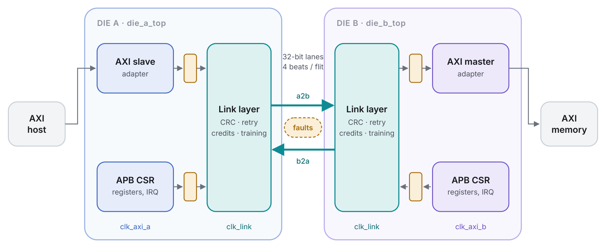</p>

The link packs AXI traffic into 128-bit **flits** protected by **CRC-16**, numbers them for
**Go-Back-N retry**, paces them with **credit flow control** on two virtual channels, brings
the link up with a **training state machine**, and crosses **three asynchronous clock
domains** through gray-code FIFOs only.

> **UCIe-inspired, not UCIe-compliant.** The flit, retry, credit and training ideas follow
> industry die-to-die practice. The formats and parameters belong to this project.

**Read it as a document:** the [12-page project report (PDF)](docs/D2D-Link_Project_Report.pdf)
covers everything below with full-page diagrams. The [8-page step-by-step explainer](docs/D2D-Link_Explained.pdf)
is a shorter introduction.

---

## At a glance

| | Result | Source |
|---|---|---|
| System regression | **44 / 44 jobs pass** (14 tests × 2 seeds, default + small config) in 10.0 min | `logs/regress/summary.md` |
| End-to-end checking | **5,108** AXI transactions, **0** lost / duplicated / reordered / corrupted | scoreboard |
| Fault injection | **3,604** faulty flits injected and recovered: 1,361 bad flits detected, 350 NAKs, 353 replays, 62 timeouts, 26 retrains | `logs/results_numbers.json` |
| Functional coverage | **233 / 233 bins (100%)** | [docs/coverage_report.md](docs/coverage_report.md) |
| Unit tests | **9 / 9** pytest cases against Python reference models | `logs/unit_final.log` |
| Formal (SymbiYosys) | **5 jobs / 10 tasks pass**: 4 unbounded proofs, 1 BMC (depth 20), 5 covers | `logs/formal_summary.txt` |
| Lint | Verilator `-Wall` **0 warnings**, Verible **0 violations**, 7 justified waivers | [docs/lint_waivers.md](docs/lint_waivers.md) |
| Area (estimate) | Die A 179,397 µm², Die B 175,826 µm², SKY130 HD standard cells | `syn/reports/summary.txt` |
| Clock (estimate) | about 48 MHz `clk_link` in SKY130 tt, before timing optimisation | [docs/results.md](docs/results.md) §6 |
| Bugs found | 1 RTL bug (fixed), 1 design characterization, 5 testbench bugs | [docs/bug_log.md](docs/bug_log.md) |

<p align="center">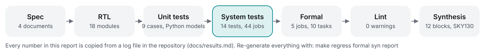</p>

## Contents
1. [Why a die-to-die link](#1-why-a-die-to-die-link)
2. [Feature list](#2-feature-list)
3. [System architecture](#3-system-architecture)
4. [The flit](#4-the-flit)
5. [Inside the link layer](#5-inside-the-link-layer)
6. [Reliability: Go-Back-N retry and credits](#6-reliability-go-back-n-retry-and-credits)
7. [Link training](#7-link-training)
8. [Clock-domain crossing](#8-clock-domain-crossing)
9. [A transaction's journey](#9-a-transactions-journey)
10. [Control and status registers](#10-control-and-status-registers)
11. [Verification](#11-verification)
12. [Results](#12-results)
13. [Bugs found](#13-bugs-found)
14. [Design decisions and the reasoning behind them](#14-design-decisions-and-the-reasoning-behind-them)
15. [Limitations and next steps](#15-limitations-and-next-steps)
16. [How to run](#16-how-to-run)
17. [Repository layout](#17-repository-layout)
18. [Documentation and report pages](#18-documentation-and-report-pages)

---

## 1. Why a die-to-die link

Large processors are increasingly built from **chiplets**: several smaller dies in one package
instead of one large die. Small dies yield better and can be reused across products, but
signals that used to be on-chip wires must now cross between dies through a limited number of
package wires. A die-to-die link controller hides that boundary, so the two dies behave as if
they were one chip.

<p align="center">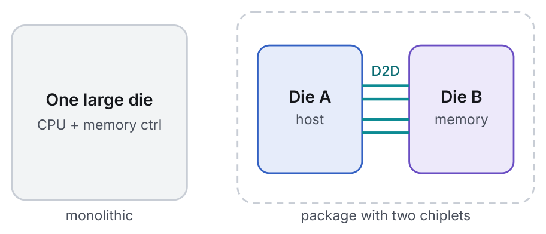</p>

A die-to-die link has to solve five problems at once:

- **Few wires:** a wide bus must be packed into fixed-size packets and sent in beats.
- **Errors:** bits flip and packets are lost. The link must detect this and resend, in order, with no duplicates.
- **Finite buffers:** the sender must never overflow the receiver, even while resending.
- **Unrelated clocks:** each side has its own clock, and data must cross between them without corruption.
- **Bring-up and recovery:** the link must train, notice a bad channel, retrain, and fail cleanly if it cannot recover.

D2D-Link is organised in three layers, mirroring the UCIe stack:

| Layer | In this design | UCIe equivalent |
|---|---|---|
| Protocol | AXI adapters turn AW/W/B/AR/R into flit bodies and back | Protocol layer |
| Link | Sequence numbers, CRC, Go-Back-N retry, credits, training | Die-to-die adapter |
| Physical lane | Ideal 32-bit parallel lane, 4 beats per flit, fault injection in the testbench | PHY (not modelled) |

## 2. Feature list

| ID | Feature |
|----|---------|
| F1 | AXI4 slave on Die A, AXI4 master on Die B: AW/W/B/AR/R, 64-bit data, 32-bit address, 4-bit ID |
| F2 | INCR bursts, AxLEN 0..15 (1..16 beats), AxSIZE passed through, full WSTRB |
| F3 | Up to 4 outstanding writes and 4 outstanding reads at the Die A slave port |
| F4 | 128-bit flits with CRC-16-CCITT, sent as 4 beats on a 32-bit lane bus |
| F5 | Two virtual channels (REQ, RSP) with independent credit counters |
| F6 | Go-Back-N retry: 8-bit sequence numbers, 16-flit replay buffer, NAK and replay timeout |
| F7 | Link training FSM: RESET → TRAIN → ACTIVE → RETRAIN → FAILED, with no data loss across a retrain |
| F8 | Three asynchronous clock domains; every crossing is a gray-code async FIFO |
| F9 | APB3 CSR block per die: control, status, error counters, thresholds, W1C interrupts |
| F10 | Fault-injection ports on the lane bus (system top only) for verification |

Full specification: [docs/spec.md](docs/spec.md).

## 3. System architecture

<p align="center">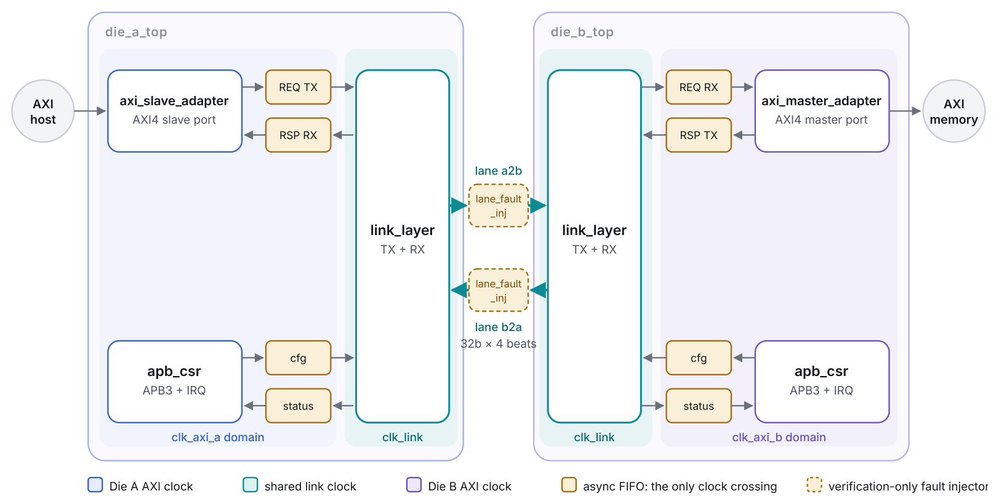</p>

Each die has an AXI adapter and an APB register block in its own AXI clock domain, and a link
layer in the shared `clk_link` domain. **Four async FIFOs per die are the only paths between
domains**: request and response data, configuration going in, and status snapshots coming
out. The verification top `d2d_system_top` joins the two dies through a `lane_fault_inj`
stage on each lane, which XORs bit errors into the data or drops beats.

| Module | Domain | Function |
|--------|--------|----------|
| `common/sync_2ff` | any | 2-flop synchronizer (used only for gray pointers) |
| `common/reset_sync` | any | async-assert, sync-deassert reset synchronizer |
| `common/async_fifo` | 2 | Cummings-style gray-pointer FIFO; also gives the writer a synchronized read count |
| `common/crc16` | – | combinational parallel CRC-16-CCITT over 112 bits |
| `common/credit_counter` | link | consume-1 / return-N counter, bounds asserted |
| `replay_buffer` | link | circular store of flit bodies with `wr_seq`, `rd_seq`, `ack_seq` |
| `flit_tx` | link | flit selection priority, header fill, CRC, 4-beat serializer |
| `flit_rx` | link | deserializer, CRC / type / pattern check, sequence check, NAK request |
| `link_training_fsm` | link | training, retrain and fail state machine, error window |
| `link_layer` | link | integrates the above, VC arbiter, credit accumulators, counters |
| `axi_slave_adapter` | axi_a | AXI4 slave → REQ flit bodies; RSP bodies → B / R |
| `axi_master_adapter` | axi_b | REQ bodies → AXI4 master; B / R → RSP bodies |
| `apb_csr` | axi | registers, snapshot shadowing, interrupts |
| `csr_link_sync` | link | link side of the CSR crossing: config in, status snapshots out |
| `lane_fault_inj` | link | XOR / drop injection plus one register stage (verification top only) |
| `die_a_top` / `die_b_top` | all | reset synchronizers, CDC FIFOs, adapter, CSR, link layer |
| `d2d_system_top` | all | two dies and two fault injectors |

Micro-architecture details: [docs/microarch.md](docs/microarch.md).

## 4. The flit

Everything crosses the link as a fixed-size 128-bit flit: a 40-bit header, a 72-bit payload
and a 16-bit CRC. A fixed size keeps the hardware simple, because the receiver always knows
where a flit ends and the CRC always covers the same bits.

<p align="center">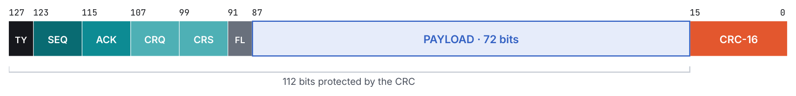</p>

| Bits | Field | Meaning |
|------|-------|---------|
| 127:124 | TYPE | flit type (below) |
| 123:116 | SEQ | sequence number, used by retry |
| 115:108 | ACK_SEQ | cumulative ACK: the next SEQ expected from the other direction |
| 107:100 | CRED_REQ_CUM | running count (mod 256) of freed REQ receive slots |
| 99:92 | CRED_RSP_CUM | same, for the RSP channel |
| 91:88 | FLAGS | LAST beat of a burst, or LOCKED in TRAIN flits |
| 87:16 | PAYLOAD | 72 bits, layout depends on TYPE |
| 15:0 | CRC | CRC-16/CCITT-FALSE (poly 0x1021, init 0xFFFF) over bits 127:16 |

| Code | Type | Retried | VC | Carries |
|------|------|---------|----|---------|
| 1 | REQ_HDR | yes | REQ | AW or AR: `is_write, id, addr, len, size, burst` |
| 2 | REQ_DATA | yes | REQ | one W beat: `wdata[64], wstrb[8]`, FLAGS.LAST = wlast |
| 3 | RSP_HDR | yes | RSP | B response: `bid, bresp` |
| 4 | RSP_DATA | yes | RSP | one R beat: `rdata[64], rid, rresp`, FLAGS.LAST = rlast |
| 0, 5, 7 | IDLE, ACK, CREDIT | no | – | fillers that still carry the ACK and credit fields |
| 6 | NAK | no | – | "resend starting at ACK_SEQ" |
| 8 | TRAIN | no | – | fixed 72-bit pattern plus the LOCKED bit |

<p align="center">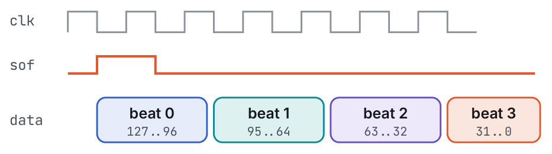</p>

A flit travels as four 32-bit beats, most significant first, with `sof` marking beat 0 so the
receiver can realign. A flit that is cut short counts as an error. While training or active,
the transmitter never goes silent: IDLE, ACK and CREDIT flits fill gaps so ACKs and credits
keep flowing.

## 5. Inside the link layer

<p align="center">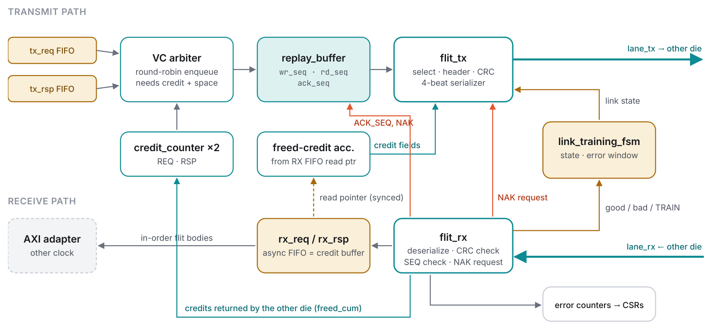</p>

**Transmit path.** Each cycle, at most one flit body moves from a TX FIFO into the replay
buffer. That needs buffer space, a credit for its virtual channel, and a link that is not in
RESET or FAILED; the two channels are arbitrated round-robin. At every flit boundary `flit_tx`
picks, in priority order: **TRAIN** while training, a pending **NAK**, the **replay buffer
entry at `rd_seq`** (new data or a resend), **ACK** if the ACK value changed, **CREDIT** if a
credit count changed, otherwise **IDLE**.

**Receive path.** `flit_rx` deserializes 4 beats and checks CRC, framing and type:

| Flit received | Action |
|---|---|
| Bad (CRC, framing, reserved type, bad TRAIN pattern) | count a CRC error; in ACTIVE, send one NAK for `exp_seq` |
| `seq == exp_seq` | push into the RX FIFO, `exp_seq++` |
| `seq` ahead of expected (gap: a flit was lost) | request a NAK |
| `seq` behind expected (duplicate after a replay) | drop silently |

| Pipeline stage | Link cycles |
|---|---|
| Enqueue TX FIFO → replay buffer | 1 |
| Select + header + CRC + serialize | 4 beats |
| Lane fault-injection register | 1 |
| Deserialize + CRC check | 4 + 1 |
| Push into RX async FIFO | 1 (+2–3 sync) |

An ACK round trip is about 24 link cycles, well under the replay timeout of 128 or 256.

## 6. Reliability: Go-Back-N retry and credits

<table>
<tr>
<td width="48%" valign="top">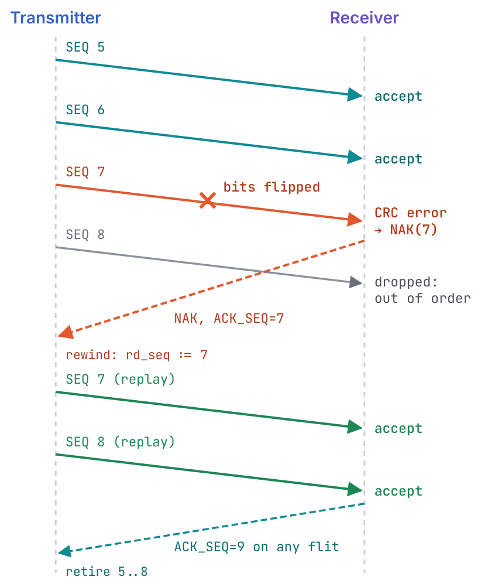</td>
<td valign="top">

**Go-Back-N retry.** Every data flit gets a sequence number, and a copy stays in the replay
buffer until the other die acknowledges it. A corrupted or out-of-order flit makes the
receiver send a **NAK**, and the transmitter rewinds `rd_seq` and resends everything from that
point. Duplicates created by the replay are dropped by sequence number. If a flit vanishes and
nothing follows it (so no gap is ever seen), a **replay timeout** triggers the same rewind.

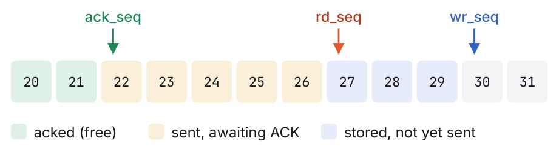

The invariant is `ack ≤ rd ≤ wr` and `wr − ack ≤ 16`. The window (16) is less than half the
sequence space (256), so the receiver can always tell a duplicate from a gap. This is
**formally proven**.

</td>
</tr>
</table>

<p align="center">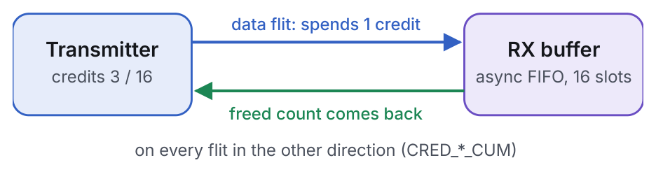</p>

**Credits.** One credit is one free slot in the receiver's buffer. The transmitter spends a
credit when a flit enters the replay buffer, and the receiver returns freed slots as a
running total on every flit going the other way. REQ and RSP have **independent credits**,
so a full request path can never block the responses that would drain it. That removes the
classic request/response deadlock. Credits stay in `[0, CREDITS]`, which is also formally
proven.

| Event | Detected by | Recovery | Seen in final regression |
|---|---|---|---|
| Bit flips / corrupted beat | CRC mismatch | NAK → Go-Back-N replay | 1,361 bad flits |
| Dropped data flit | SEQ gap at the next data flit | NAK → replay | 350 NAKs |
| Lost last flit, NAK or ACKs | replay timer | replay from oldest unacknowledged | 62 timeouts |
| Error burst above threshold | error-window counter | RETRAIN, then replay | 26 retrains |
| Retrain keeps failing | attempt counter | FAILED + interrupt; software toggles ENABLE | tested |
| Duplicate after replay | SEQ behind expected | dropped | 353 replays |

## 7. Link training

<p align="center">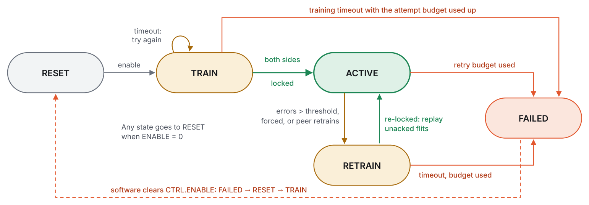</p>

Before any data flows, both dies must agree the link works. Each side sends TRAIN flits;
after `TRAIN_GOOD` (8) good ones in a row it is **locked** and advertises that in its own
TRAIN flits. When both sides are locked, the link goes ACTIVE and replays anything still
unacknowledged. More than `ERR_THRESH` (8) bad flits in a 256-flit window sends it to
RETRAIN. When the retry budget (`MAX_RETRAIN` = 4) is used up, it goes to FAILED, raises an
interrupt and waits for software to toggle `CTRL.ENABLE`.

**No data is lost across a retrain.** Training never touches the replay buffer, sequence
numbers, credits or receive FIFOs. A TRAIN flit with LOCKED=1 arriving while ACTIVE is
ignored. Without that rule the two state machines can livelock, knocking each other back into
training forever.

## 8. Clock-domain crossing

<table>
<tr>
<td width="48%" valign="top">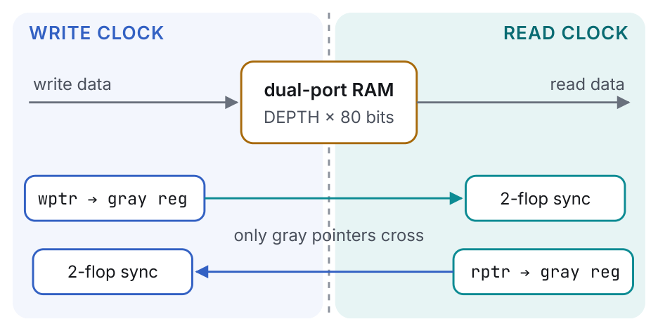</td>
<td valign="top">

`clk_axi_a`, `clk_axi_b` and `clk_link` are mutually asynchronous. Sampling a changing
multi-bit value from another clock can capture a half-updated number, so **the only signals
that cross are gray-coded FIFO pointers**, each registered and passed through a 2-flop
synchronizer. Gray code changes one bit per step, so a sampled pointer is always the old or
the new value. The FIFO is **formally proven with two unconstrained, unrelated clocks**.

There are exactly **8 crossings** (4 per die): REQ and RSP data, a 30-bit config message and
an 83-bit status snapshot. Error counters never cross bit by bit. The link domain pushes a
complete snapshot through a FIFO, so a register read is coherent.

</td>
</tr>
</table>

Credit return reuses the receive FIFO's already-synchronized read pointer, so it adds no
extra crossing. It lags 2–3 cycles, so credits come back late, never early. Details:
[docs/cdc.md](docs/cdc.md).

## 9. A transaction's journey

<p align="center">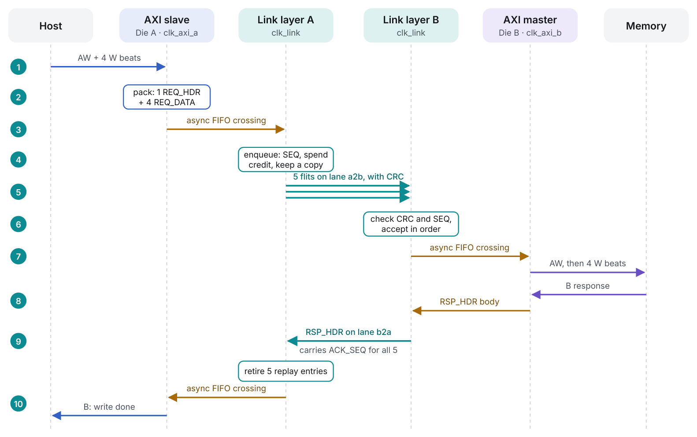</p>

1. The host issues AW and four W beats; Die A accepts the AW only with fewer than 4 writes outstanding.
2. The slave adapter packs them into one REQ_HDR and four REQ_DATA flit bodies.
3. The bodies cross from `clk_axi_a` to `clk_link` through the request async FIFO.
4. The link layer assigns sequence numbers, spends credits and keeps a copy in the replay buffer.
5. `flit_tx` adds header fields and CRC and sends 5 flits on lane a2b.
6. Die B's `flit_rx` checks CRC and SEQ and accepts them in order.
7. They cross into `clk_axi_b`; the master adapter drives AW and the W beats to memory.
8. The B response becomes an RSP_HDR body on the response channel.
9. It travels back on lane b2a, carrying `ACK_SEQ` for all 5 request flits, which retires them from the replay buffer.
10. It crosses into `clk_axi_a` and the host sees B. Reads work the same way, with R beats returning as RSP_DATA flits.

Die B executes strictly one transaction at a time, in arrival order. That is legal AXI, keeps
the ordering argument trivial, and lets the scoreboard predict every response exactly. It is a
deliberate trade of throughput for verifiability.

## 10. Control and status registers

APB3, one block per die, no wait states, unmapped addresses return `PSLVERR`.

| Offset | Register | Access | Description |
|--------|----------|--------|-------------|
| 0x00 | CTRL | RW | [0] ENABLE, [1] FORCE_RETRAIN (pulse) |
| 0x04 | STATUS | RO | [2:0] link state, [3] LINK_UP |
| 0x08 | CRC_ERR_CNT | RO | bad flits received (saturating) |
| 0x0C | NAK_CNT | RO | NAKs sent by this die's receiver |
| 0x10 | REPLAY_CNT | RO | replays started by this die's transmitter |
| 0x14 | TIMEOUT_CNT | RO | replay timeouts |
| 0x18 | RETRAIN_CNT | RO | ACTIVE → RETRAIN transitions |
| 0x1C | ERR_CFG | RW | [7:0] ERR_THRESH, [11:8] MAX_RETRAIN |
| 0x20 | ERR_WINDOW | RW | window length in received flits |
| 0x24 | IRQ_EN | RW | LINK_DOWN, RETRAIN, LINK_FAILED, CRC_ERR |
| 0x28 | IRQ_STATUS | W1C | same bits, write 1 to clear |
| 0x2C | ID | RO | constant 0xD2D1_0001 |

## 11. Verification

<p align="center">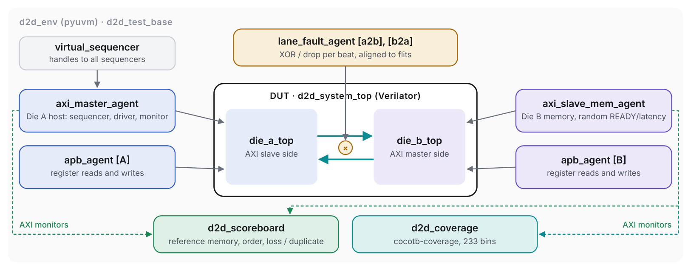</p>

| Level | Tool | Purpose |
|---|---|---|
| Unit | cocotb + Verilator | each block against a Python model before integration |
| System | pyuvm + cocotb-coverage + Verilator | constrained-random end-to-end on `d2d_system_top` with fault injection |
| Formal | SymbiYosys (z3, ABC PDR) | safety invariants of FIFO, credits, replay pointers, FSM and a reduced retry link |
| SV-UVM | SystemVerilog UVM 1.2 | a classic SV UVM AXI agent and smoke test (`uvm_sv/`, for EDA Playground) |
| Static | Verilator `-Wall`, Verible, Yosys | lint cleanliness, synthesizability, no latches |

**The scoreboard** keeps a reference memory updated in Die A acceptance order (honouring
WSTRB) and compares every read beat against it. It also checks that each request seen at Die B
equals the next Die A request, which catches loss, duplication or reordering where it
happens. At the end of each test it checks that nothing is outstanding, no extra responses
arrived and both links are ACTIVE. Every bus-functional model drives on the falling edge and
samples just before the rising edge, so combinational READY signals are observed correctly.

| Test | What it stresses |
|---|---|
| `smoke` | train, one write, one read-back |
| `random_rw` | 200 random reads and writes, random length, ID, WSTRB, address |
| `max_burst` | 16-beat bursts back to back |
| `outstanding_stress` | 4 writes + 4 reads in flight against a slow memory |
| `credit_starvation` | host stalls BREADY/RREADY until response credits run out |
| `backpressure_random` | random VALID gaps and READY at both ends |
| `crc_error_retry` | random single/multi-bit flips on 1% of flits, both directions |
| `flit_drop_timeout` | whole flits dropped, including a sparse phase only timeouts can recover |
| `error_storm_retrain` | heavy corruption burst forces RETRAIN, then clean traffic |
| `link_fail_and_recover` | corrupt until FAILED, then recover through APB, with no loss |
| `csr_access` | reset values, RW, RO, W1C, unmapped address → PSLVERR, forced retrain |
| `ltssm_arcs` | directed FSM corners: ACTIVE→FAILED, RETRAIN→RESET, TRAIN→RESET, TRAIN→FAILED |
| `clock_ratio_sweep` | several unrelated clock period triples |
| `reset_during_traffic` | reset mid-burst, retrain, new traffic |

Every test takes a seed. The regression runs each test over several seeds and both parameter
configurations in parallel and writes JUnit XML. Full plan:
[docs/verification_plan.md](docs/verification_plan.md).

**Formal proofs** (small configuration):

| Job | Method | What is proven | Result |
|---|---|---|---|
| fifo | ABC PDR (unbounded) | no overflow/underflow, 1-bit gray steps, popped data = oldest pushed, two free clocks | PASS |
| credit | ABC PDR (unbounded) | credits in [0, MAX]; conservation even with late or lost credit returns | PASS |
| replay | k-induction | ack ≤ rd ≤ wr, window ≤ depth, full never accepts, rewind lands on ack | PASS |
| retry | ABC PDR (unbounded) | reduced Go-Back-N link over a lossy channel delivers exactly 0, 1, 2, … | PASS |
| ltssm | BMC depth 20 | legal states; ACTIVE only with lock; FAILED only after the budget | PASS |

## 12. Results

<table>
<tr>
<td width="50%" valign="top">

**From injected fault to recovery** (all 44 runs)

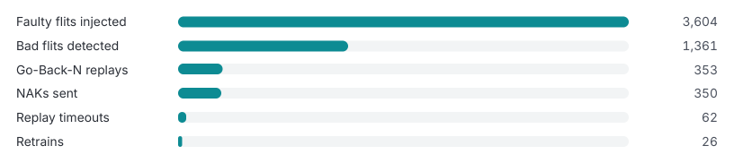

Fewer bad flits are detected than injected, as expected. Drops remove whole flits without a
CRC event (they are recovered by a SEQ gap or a timeout), and errors injected while a link is
retraining or failed count only as CRC errors.

</td>
<td valign="top">

**Functional coverage**: 233 / 233 bins

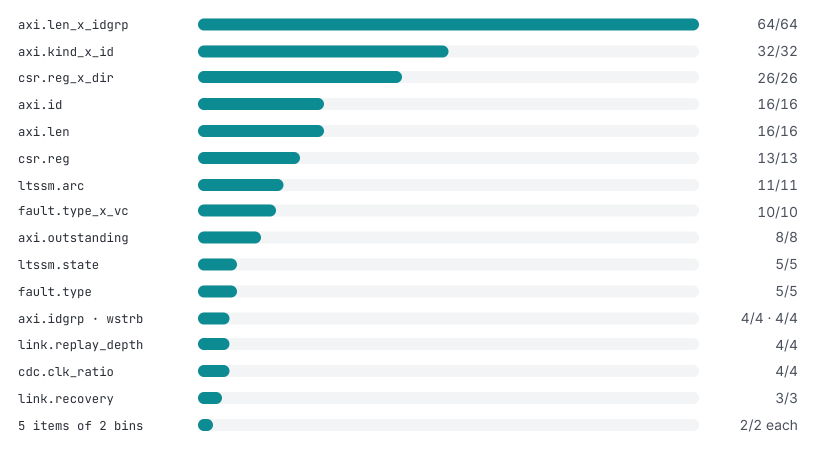

An earlier full run left 4 FSM arcs and writes to read-only registers uncovered. They were
closed with the directed `ltssm_arcs` test and new checks in `csr_access`, which assert the
behaviour rather than just sampling it.

</td>
</tr>
</table>

**Synthesis estimates** (Yosys 0.33 + ABC, SKY130 HD `tt_025C_1v80`, standard-cell area
only, no latches inferred):

<p align="center">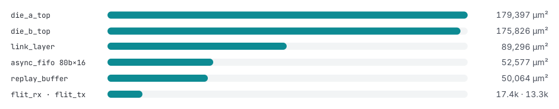</p>

| Block | Cells | Area (µm²) | Flops | ABC comb. delay (ps) |
|---|---|---|---|---|
| die_a_top | 12,126 | 179,397 | 4,309 | 20,373 |
| die_b_top | 12,499 | 175,826 | 4,254 | 20,078 |
| link_layer | 7,188 | 89,296 | 1,894 | 20,827 |
| async_fifo (80b × 16) | 2,631 | 52,577 | 1,320 | 14,781 |
| replay_buffer (16 × 80b) | 2,935 | 50,064 | 1,304 | 11,038 |
| crc16 (112-bit) | 325 | 7,535 | 0 | 9,025 |

The worst combinational path, about 20.8 ns through the replay-buffer read mux, header
assembly and the 112-bit parallel CRC, bounds `clk_link` at roughly **48 MHz** in SKY130 tt.
This is an estimate with no wires, clock tree or setup time, and OpenSTA was not available.
All numbers and their log sources: [docs/results.md](docs/results.md).

## 13. Bugs found

<table>
<tr>
<td width="48%" valign="top">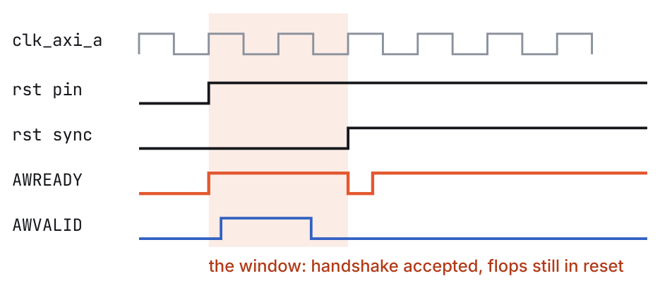</td>
<td valign="top">

**RTL bug #1: AXI READY asserted while the synchronized reset was still active.**
The pin reset deasserts 2 clocks before the internally synchronized reset. In that window,
`axi_slave_adapter` built `AWREADY` from reset-state values, so it read 1. A host starting
right after reset completed an AW handshake that the still-in-reset flops never captured: the
W beats were never accepted and the bus hung. `apb_csr.pready` had the same flaw.

**Caught by** `reset_during_traffic` (seed 112). **Fix:** qualify AWREADY, ARREADY, WREADY and
PREADY with the synchronized reset.

</td>
</tr>
</table>

**Investigated, not a bug.** At a uniform 3% flit error rate the link went to FAILED. The
retrain threshold (more than 8 bad flits per 256, about 3.1%) is crossed regularly at that
rate, so retrains recur, the budget runs out and FAILED follows, exactly as specified. The
thresholds encode a bit-error-rate budget, and the registers make it tunable.

**Testbench bugs**: 5, each fixed without weakening a check (BFM sampling edge, a unit-test
handshake, a NAK masking the timeout path, a driver surviving reset, scoreboard accounting of
reset-flushed transactions). Full write-ups: [docs/bug_log.md](docs/bug_log.md).

## 14. Design decisions and the reasoning behind them

**Why cumulative ACK and credit fields instead of increments?**
An increment carried on a corrupted flit is gone for good: a credit leaks and the link
eventually deadlocks. A running total heals itself, because the next good flit carries the
up-to-date value and the transmitter takes the difference. No separate reliability mechanism
is needed for ACKs or credits.

**Why is the replay window smaller than half the sequence space?**
The receiver classifies `(seq − expected) mod 256`: below 128 is a gap (NAK), otherwise a
duplicate (drop). A window of 16 keeps the two cases from ever overlapping.

**Why are credits consumed at enqueue and not at send?**
A flit is resent from the replay buffer without spending a new credit, so replays are
credit-neutral and an in-order flit always finds a free slot at the receiver (asserted).

**Why are header fields filled at send time?**
The replay buffer stores only the 80-bit body. SEQ, ACK, credits and CRC are added as the
flit goes out, so a replayed flit carries fresh ACK and credit information instead of stale
values.

**Why is the receive buffer the CDC FIFO?**
The credit return comes straight from the FIFO read pointer that is already synchronized into
the link domain. That removes a whole crossing, and the lag only makes credits conservative.

**How is protocol deadlock avoided?**
Separate request and response virtual channels with independent credits, so responses can
always drain even when the request path is full.

**What limits the clock frequency, and how would you raise it?**
The 112-bit parallel CRC on the send and receive paths. To raise it: register the CRC check
(one extra receive stage), compute the CRC per 32-bit beat, and replace the flop-based replay
and FIFO arrays (about 2,600 of ~4,300 flops per die) with SRAM.

## 15. Limitations and next steps

**Known limitations** ([docs/spec.md](docs/spec.md) §9):
- Die B runs one transaction at a time in order; no per-ID reordering, so link utilization is low.
- One flit per AXI beat: 80 useful bits out of 128, 4 link cycles per beat.
- Only INCR bursts are verified; exclusive access, QoS, cache and prot signals are not carried.
- Both dies are assumed to reset together; an independent single-die reset mid-traffic is not supported.
- FAILED needs software to toggle ENABLE (in-flight traffic is preserved across it).
- The lane is an ideal parallel bus: no PHY, deskew, scrambling or lane repair.
- Injected errors stay within CRC-16's guaranteed detection envelope (≤ 3 bit flips, bursts ≤ 16 bits).
- `uvm_sv/` is syntax-checked with Verible but not simulated locally (no SystemVerilog UVM simulator in this flow).
- Code coverage (Verilator `--coverage`) was not collected; the len × ID cross uses 4 ID groups.

**Next steps:** run the SV-UVM agent on EDA Playground; pipeline the CRC and move buffers to
SRAM to raise the clock; per-ID reordering and multi-beat flits to raise throughput; a PHY
model with skew and scrambling; OpenSTA timing; code coverage.

## 16. How to run

Everything runs in a Docker image with pinned open-source tools: Verilator 5.020, Yosys 0.33,
SymbiYosys, z3, Verible, and Python 3.12 with cocotb 1.9.2, pyuvm 3.0.0 and cocotb-coverage
1.2.0.

```bash
make image          # build the d2d-eda image (docker/Dockerfile)
make lint           # Verilator -Wall + Verible
make unit           # block-level cocotb tests
make regress        # all system tests, 2 seeds, default + small config, parallel, 15 min cap
make formal         # SymbiYosys jobs
make syn            # Yosys + SKY130 area/delay estimates
make report         # merge coverage -> docs/coverage_report.md
make all            # lint unit regress formal syn report

# one test with a fixed seed
scripts/dk.sh "python tb/uvm/run_test.py --test crc_error_retry --seed 42 --config default"
```

If your network does TLS inspection (antivirus or corporate proxy), put its root certificate
in `docker/local-ca.crt` (git-ignored) before `make image`.

**SystemVerilog UVM on EDA Playground:** select UVM 1.2, add `uvm_sv/*.sv`, `rtl/**/*.sv` and
`rtl/*.svh`, and set the top to `tb_top`.

**Rebuild the reports** (Windows host with Edge or Chrome):
`python scripts/make_report_pdf.py` regenerates the 12-page report,
`python scripts/report/export_figures.py` regenerates every image in this README, and
`python scripts/make_explainer_pdf.py docs/D2D-Link_Explained.pdf logs/coverage_merged.json`
regenerates the explainer.

## 17. Repository layout

```
rtl/            synthesizable RTL, one module per file; rtl/common/ shared blocks; rtl/files.f
tb/unit/        cocotb unit tests + Python reference models (crc16, async_fifo, credits, replay, flit tx/rx, FSM)
tb/uvm/         pyuvm environment (d2d_env.py), 14 tests (d2d_tests.py), runner (run_test.py)
uvm_sv/         SystemVerilog UVM AXI agent + smoke test
formal/         SymbiYosys jobs, property wrappers, per-task logs
syn/            synthesis reports (the Liberty file is downloaded on demand, not committed)
scripts/        regression, formal, lint, synthesis, coverage report, PDF and figure generators
docs/           spec, microarch, CDC, verification plan, coverage, bug log, results, lint waivers, PDFs, images
logs/           regression, unit, formal, lint and tool-version logs behind every number above
docker/         Dockerfile of the tool environment
```

## 18. Documentation and report pages

[Specification](docs/spec.md) · [Micro-architecture](docs/microarch.md) · [CDC report](docs/cdc.md) ·
[Verification plan](docs/verification_plan.md) · [Coverage report](docs/coverage_report.md) ·
[Bug log](docs/bug_log.md) · [Results](docs/results.md) · [Lint waivers](docs/lint_waivers.md)

### Project report, 12 pages ([PDF](docs/D2D-Link_Project_Report.pdf))

<table>
<tr>
<td><a href="docs/images/report/page-01.png">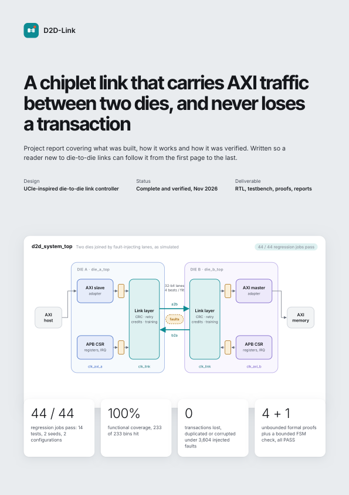</a></td>
<td><a href="docs/images/report/page-02.png">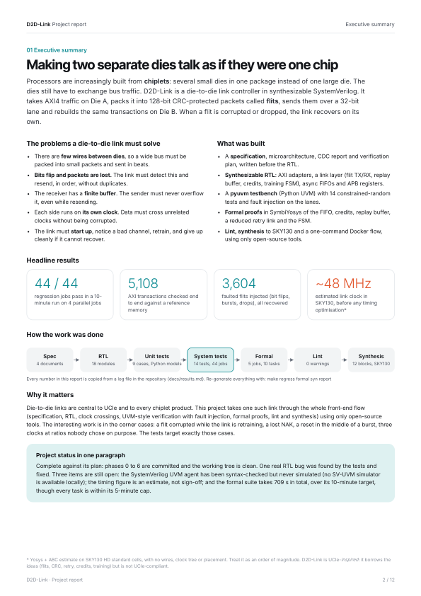</a></td>
<td><a href="docs/images/report/page-03.png">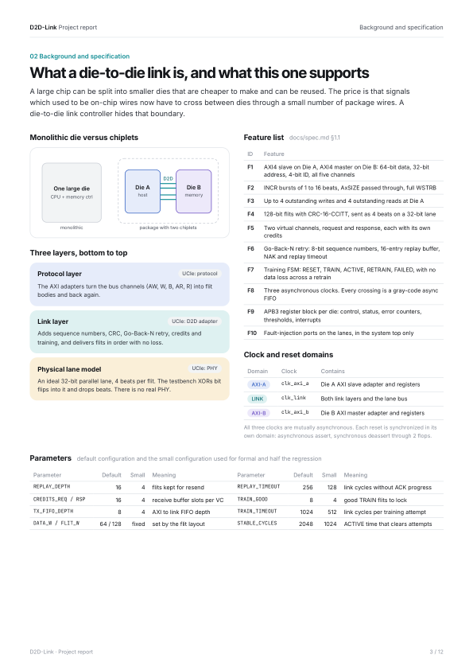</a></td>
<td><a href="docs/images/report/page-04.png">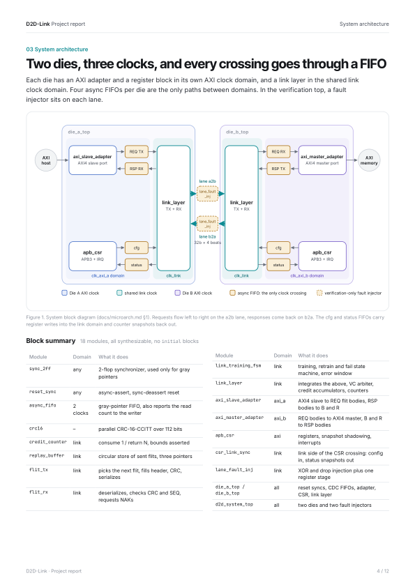</a></td>
</tr>
<tr>
<td><a href="docs/images/report/page-05.png">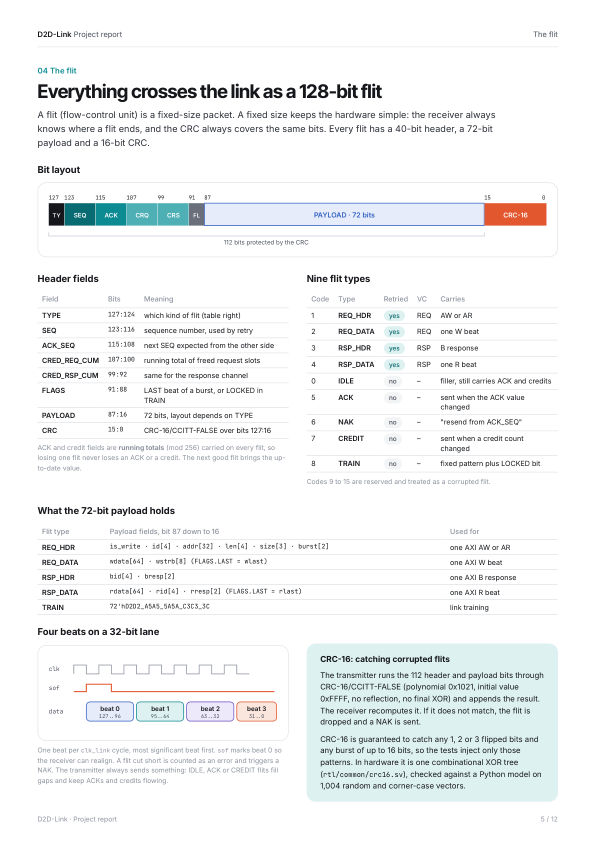</a></td>
<td><a href="docs/images/report/page-06.png">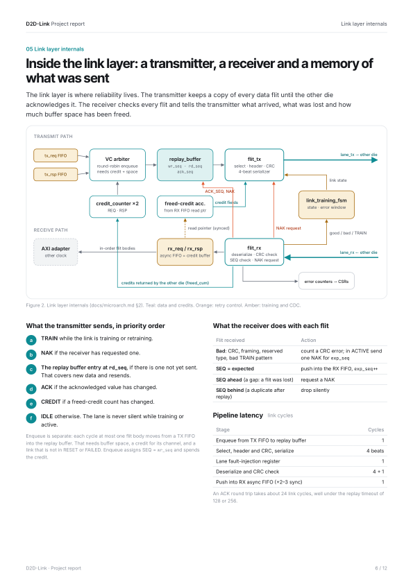</a></td>
<td><a href="docs/images/report/page-07.png">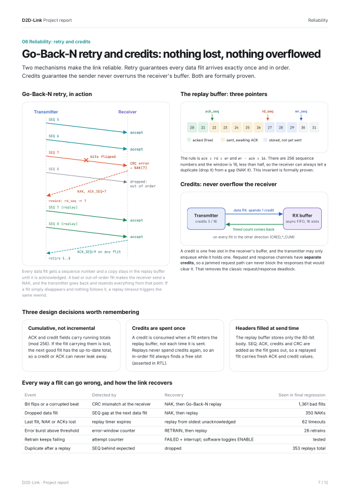</a></td>
<td><a href="docs/images/report/page-08.png">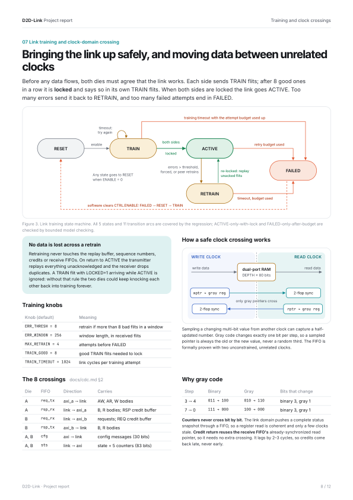</a></td>
</tr>
<tr>
<td><a href="docs/images/report/page-09.png">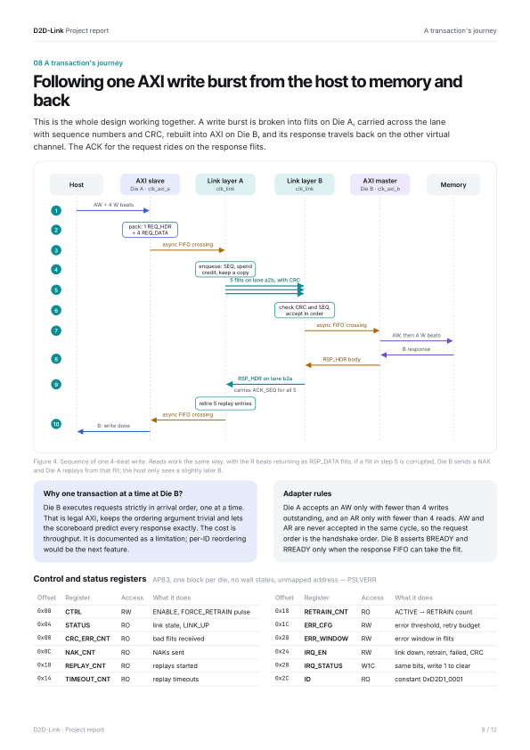</a></td>
<td><a href="docs/images/report/page-10.png">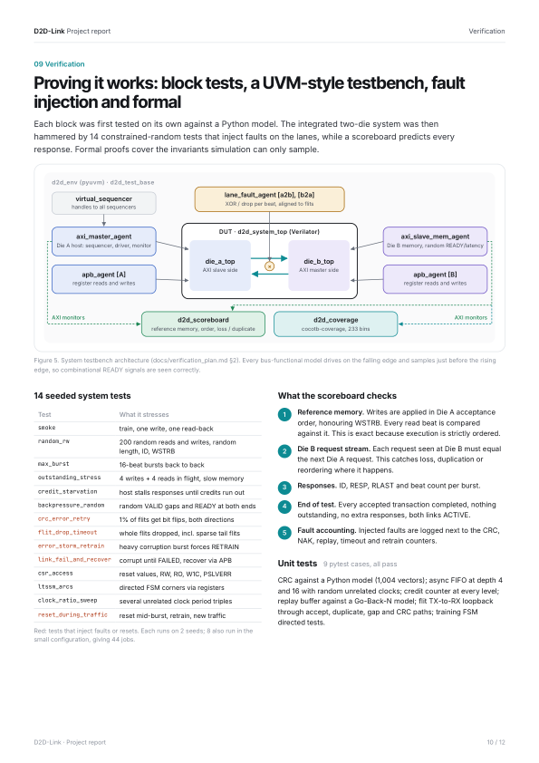</a></td>
<td><a href="docs/images/report/page-11.png">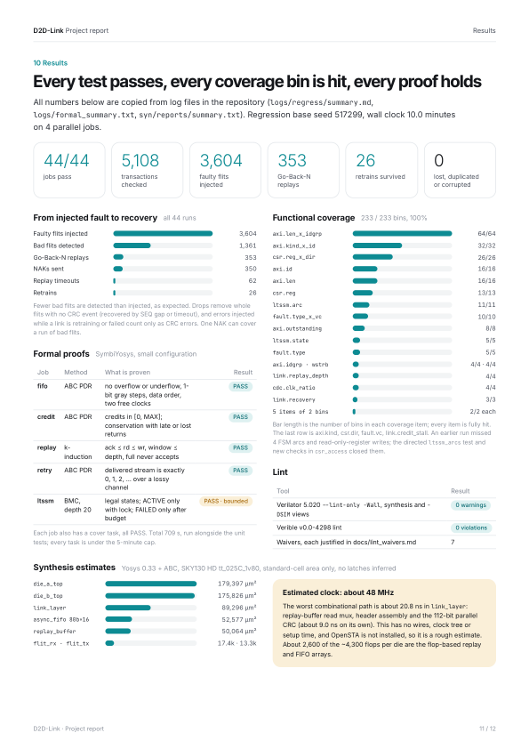</a></td>
<td><a href="docs/images/report/page-12.png">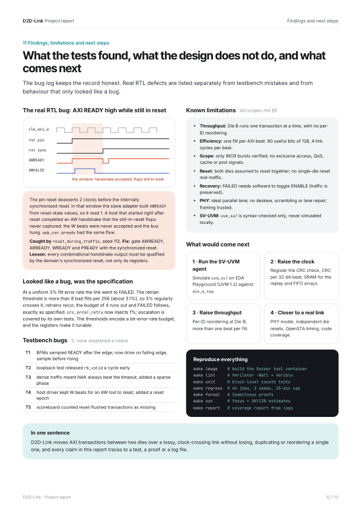</a></td>
</tr>
</table>

### Step-by-step explainer, 8 pages ([PDF](docs/D2D-Link_Explained.pdf))

<table>
<tr>
<td><a href="docs/images/explainer/page-1.png">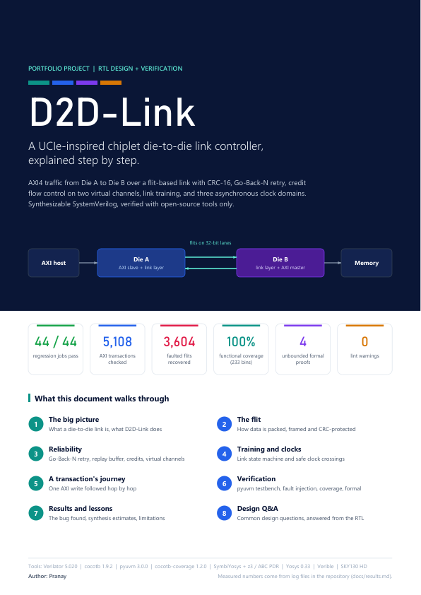</a></td>
<td><a href="docs/images/explainer/page-2.png">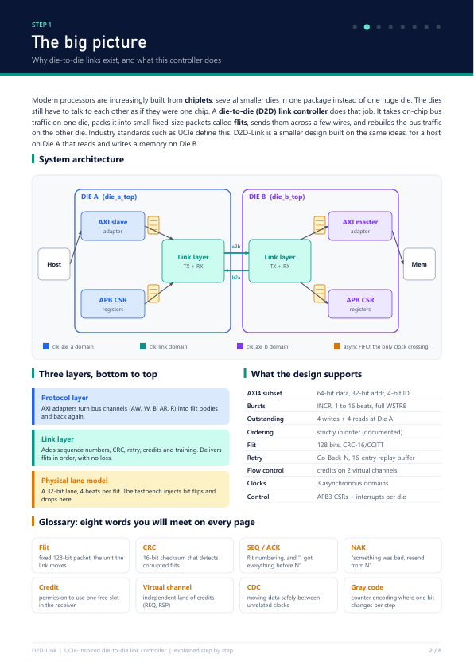</a></td>
<td><a href="docs/images/explainer/page-3.png">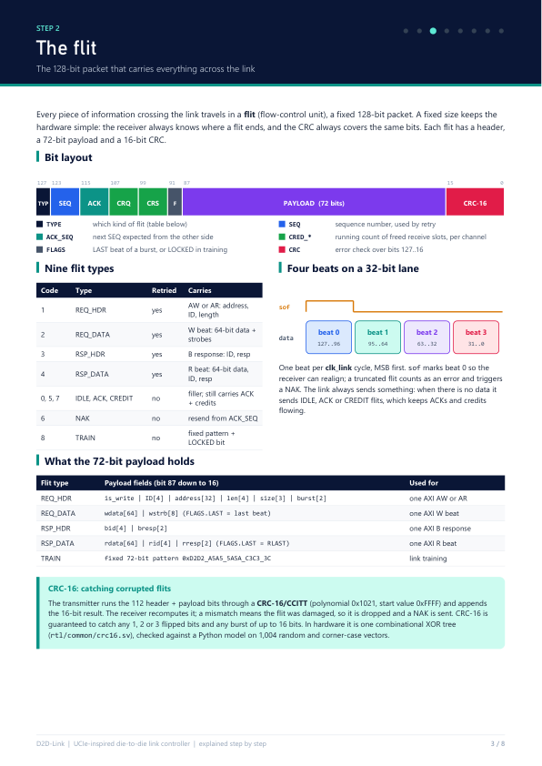</a></td>
<td><a href="docs/images/explainer/page-4.png">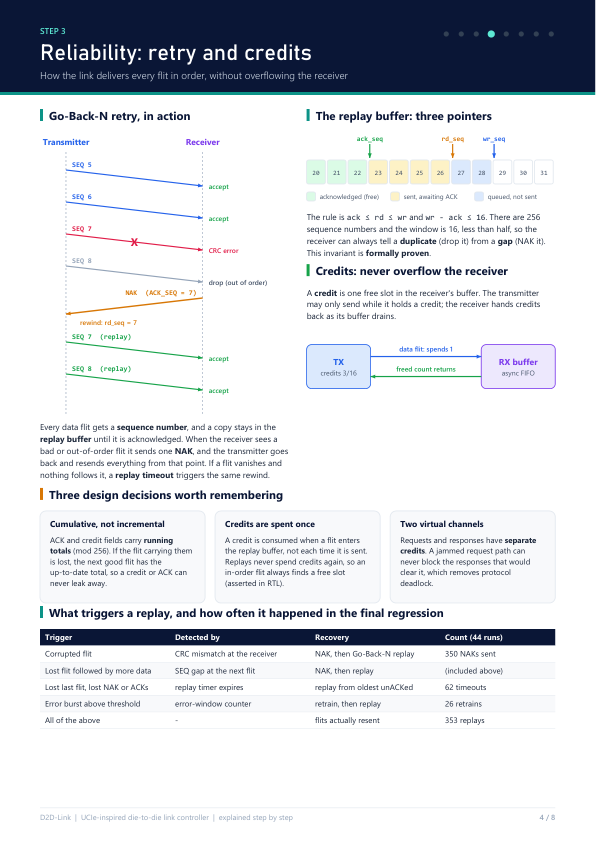</a></td>
</tr>
<tr>
<td><a href="docs/images/explainer/page-5.png">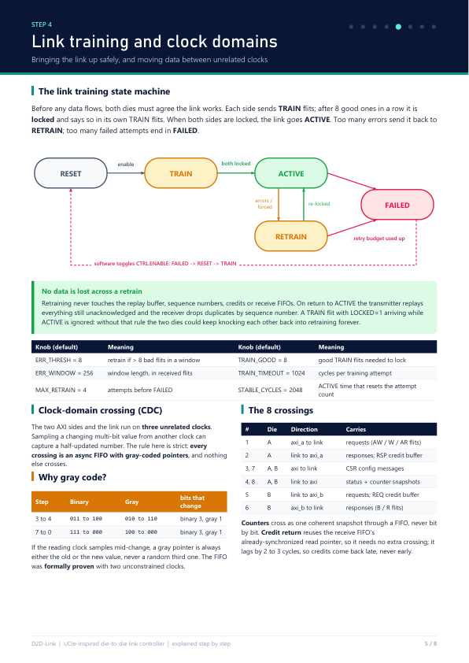</a></td>
<td><a href="docs/images/explainer/page-6.png">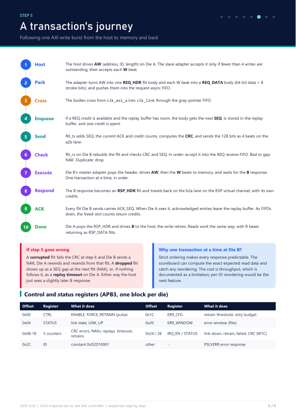</a></td>
<td><a href="docs/images/explainer/page-7.png">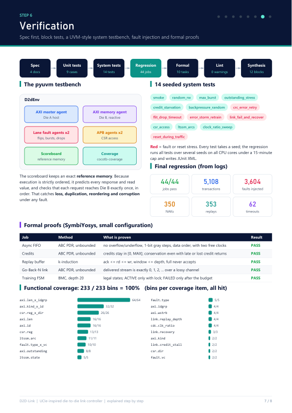</a></td>
<td><a href="docs/images/explainer/page-8.png">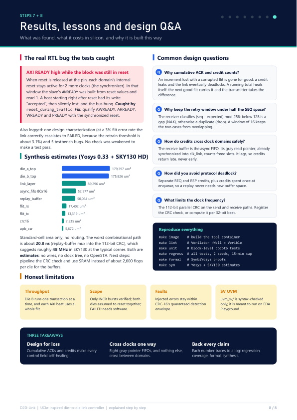</a></td>
</tr>
</table>

---

**Author:** Pranay V ([@PranayViswaraj](https://github.com/PranayViswaraj)). Questions and
feedback are welcome through GitHub issues.
