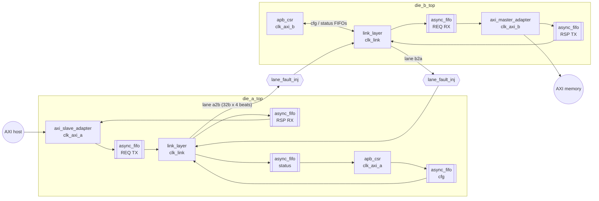
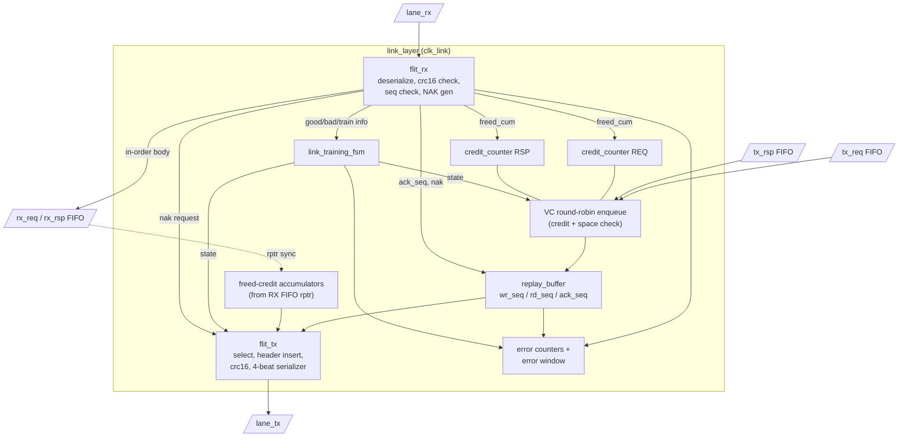

# D2D-Link Micro-architecture

## 1. System block diagram

## 2. Link layer internals

### 2.1 Pipeline and latency (link cycles)
| Stage | Cycles |
|-------|--------|
| Enqueue from TX FIFO to replay buffer | 1 |
| Flit select + header/CRC (combinational) + serialize | 4 beats (beat 0 registered) |
| Lane fault-injection register stage | 1 |
| Deserialize + CRC check | 4 beats + 1 |
| Push into RX async FIFO | 1 (+ 2-3 cycles of read-domain sync) |

Round trip for an ACK is about 4 (data flit) + 1 + 5 + up to 4 (waiting for the next reverse
flit boundary) + 4 + 1 + 5 ≈ 24 link cycles, well under `REPLAY_TIMEOUT` (128/256).

## 3. Block summary

| Module | Domain | Function |
|--------|--------|----------|
| `common/sync_2ff` | any | 2-flop synchronizer (parameterized width; used only for gray pointers) |
| `common/reset_sync` | any | Async-assert, sync-deassert reset synchronizer |
| `common/async_fifo` | 2 | Cummings-style gray-pointer FIFO, `DEPTH` power of 2, exposes write-domain read count |
| `common/crc16` | – | Combinational parallel CRC-16-CCITT over 112 bits |
| `common/credit_counter` | link | Counter with consume-1 / return-N, bounds asserted |
| `replay_buffer` | link | Circular store of flit bodies indexed by `seq[log2(DEPTH)-1:0]`, three pointers |
| `flit_tx` | link | Flit selection priority, header fill, CRC, serializer |
| `flit_rx` | link | Deserializer, CRC/type/pattern check, sequence check, NAK request |
| `link_training_fsm` | link | Training/retrain/fail state machine, error window |
| `link_layer` | link | Integrates the above + VC arbiter + credit accumulators + counters |
| `axi_slave_adapter` | axi_a | AXI4 slave → REQ flit bodies; RSP flit bodies → B/R |
| `axi_master_adapter` | axi_b | REQ flit bodies → AXI4 master; B/R → RSP flit bodies |
| `apb_csr` | axi | Registers, snapshot shadowing, IRQ |
| `lane_fault_inj` | link | XOR/drop injection + 1 register stage (verification top only) |
| `die_a_top` / `die_b_top` | all | Reset syncs, CDC FIFOs, adapter, CSR, link layer |
| `d2d_system_top` | all | Two dies + two fault injectors |

## 4. Key design decisions
1. **Cumulative ACK and credit fields on every flit.** They need no separate retry, and a lost
   flit can never leak a credit or an ACK. Increment-style credit returns would need their own
   reliability mechanism.
2. **The RX VC buffer is the CDC FIFO.** The credit return comes straight from the FIFO read
   pointer that is already synchronized into the link domain, so the design adds no extra
   crossing.
3. **Credits are consumed at enqueue into the replay buffer**, not when a flit is sent, so
   replays are credit-neutral.
4. **Header fields are filled at send time**, so replayed flits carry fresh ACK/credit values.
   The replay buffer stores only the 80-bit body. The SEQ of the flit being sent is `rd_seq`
   itself, and the storage index is `rd_seq[log2(DEPTH)-1:0]`.
5. **Strict in-order AXI execution at Die B.** This keeps the ordering proof trivial and the
   scoreboard exact. It is a deliberate scope reduction: throughput is traded for an exact ordering model.
